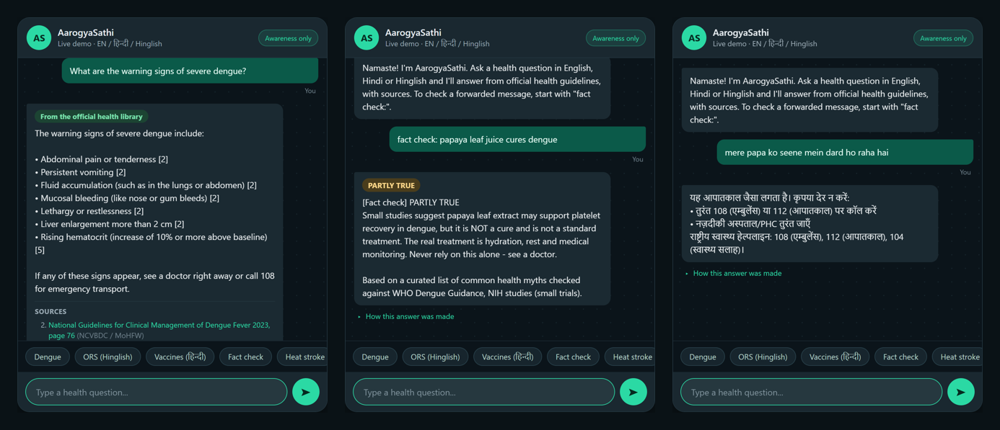
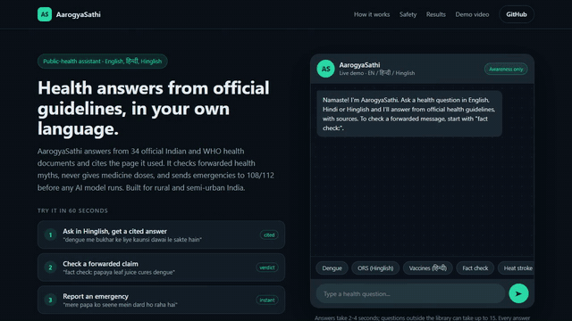
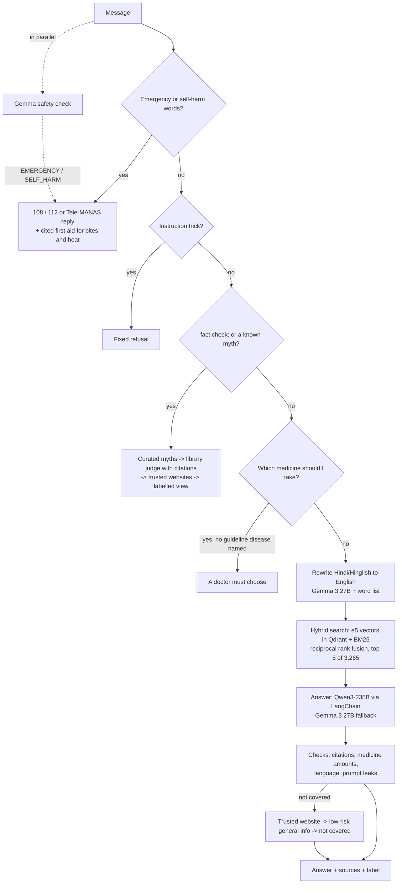

# AarogyaSathi

[](https://github.com/salman-mohammad-khan/aarogyasathi-rag/actions/workflows/ci.yml)

**A multilingual public-health assistant for rural India: answers cited from official Indian and WHO guidelines, in
English, Hindi and Hinglish, with safety checks around the model.**

It answers from a library of 34 official documents (MoHFW, NCDC, NCVBDC, NHM, NHSRC ASHA modules, NTEP, WHO),
shows the page each answer comes from, fact-checks forwarded health myths, never gives medicine doses, and sends
emergencies to 108/112 before any AI model runs.

> Awareness only. It is not a doctor and never diagnoses or prescribes.

**Live demo:** [aarogyasathi.nova-care.xyz](https://aarogyasathi.nova-care.xyz) (Oracle Cloud Arm VM; models on
Amazon Bedrock, Mumbai).

**Origin.** This began as a college minor project (ES-451, SIH-25049). This repository is the standalone version I
maintain, with the full commit history. The submitted college version, with its report and paper, is archived at
[salman-mohammad-khan/AarogyaSathi](https://github.com/salman-mohammad-khan/AarogyaSathi). The first version of this
repository (a rule-based chatbot with an LLM attached) is kept in the tag `v1-legacy`; v2, described here, is a
rebuild around retrieval-augmented generation, documented step by step in [`docs/v2/BUILD_LOG.md`](docs/v2/BUILD_LOG.md).



*Left to right: a cited answer from the national dengue guideline, a forwarded myth checked, and an emergency reply.
Captured from the live site.*

**Demo video** (87 s): a cited answer, Hinglish, a dose question, a fact-check, a trusted-website answer
and an emergency. [Watch or download the MP4](https://github.com/salman-mohammad-khan/aarogyasathi-rag/raw/main/docs/demo.mp4).

[](https://github.com/salman-mohammad-khan/aarogyasathi-rag/raw/main/docs/demo.mp4)

## What it does

- **Answers health questions with citations.** Search finds the 5 most relevant passages among 3,265 taken from 34
  official documents; the model writes only from them and cites each fact (`[1]`, `[2]`), and the page shows the
  document, page number and a link that opens the PDF at that page.
- **Speaks the user's language.** English, Hindi (Devanagari) and Hinglish (Hindi typed in English letters). Hindi and
  Hinglish questions are rewritten into English for search (with a word list for village terms such as *loo* = heat
  stroke, *dast* = diarrhoea), and the answer comes back in the user's language. Follow-up questions ("aur bachchon
  mein?") are understood.
- **Goes beyond the library carefully.** If the library has no answer: a trusted public-health website (WHO, MoHFW,
  NHM, PIB, ICMR, NHS, CDC, MedlinePlus) with its link; for low-risk topics only, short general information that is
  clearly labelled; otherwise an honest "not covered, ask your ASHA worker or doctor". Every answer carries a coloured
  label saying which of these it is.
- **Fact-checks forwarded messages.** "fact check: papaya leaf juice cures dengue" gets VERIFIED, MYTH, PARTLY TRUE,
  NOT ENOUGH EVIDENCE or LIKELY MYTH, with what the verdict is based on: 64 curated myths, then the library (with
  citations), then trusted websites, then a cautious labelled view. No made-up confidence percentages.
- **Puts safety first.** Emergencies and self-harm are answered by rules before any model (108/112, Tele-MANAS
  14416), with a Gemma check running alongside for wordings the rules miss; dog bites and heat illness also get cited
  first aid. Medicine amounts are removed by a code check, choosing a medicine is referred to a doctor, and
  instruction tricks ("ignore your rules") are refused by a rule.

## How it works



| Step | Code | What happens |
|---|---|---|
| Library | `ingest/`, `sources/manifest.yaml` | 38 listed sources (34 used) downloaded, cleaned and cut into 1,200-character chunks per page with section headings, language and a medicine-dose flag (LangChain text splitter) |
| Index | `app/retrieval/index.py` | multilingual-e5-base vectors and chunk metadata in Qdrant (local mode, 29 MB) |
| Search | `app/retrieval/search.py`, `rewrite.py`, `keyword.py`, `fusion.py` | English rewrite for Hindi/Hinglish, dense (e5) + keyword (BM25) search, reciprocal rank fusion (k = 60) |
| Answer | `app/answer/chain.py`, `prompt.py`, `citations.py`, `checks.py` | LangChain LCEL chain with `ChatBedrockConverse`; numbered sources; `with_fallbacks` to Gemma; code checks on the reply |
| Beyond the library | `app/answer/trusted_web.py`, `general.py`, `outside.py` | allowlisted web search (ddgs) + trafilatura; risk label (NOT_HEALTH / HIGH / LOW) gates general answers |
| Fact-check | `app/answer/factcheck.py`, `app/factcheck/verifier.py` | curated myth match (e5, disease and remedy conflict checks), library and website judges, safe-direction model view |
| Safety | `app/core/safety.py`, `safety_llm.py`, `guard.py`, `app/pipeline.py` | emergency and self-harm word rules (English, Hindi, Hinglish), Gemma second check, instruction guard, medicine-choice rule |

## Results

Measured with the production models on test questions written for this purpose (English, Hindi, Hinglish). Full
tables, every answer and every judge verdict are in [`eval/results/`](eval/results/); the reasoning behind each choice is in
[`docs/v2/BUILD_LOG.md`](docs/v2/BUILD_LOG.md).

| What was measured | Test | Result |
|---|---|---|
| Whole pipeline, end to end | 50 new messages (15 questions, 12 emergencies, 8 dose questions, 8 fact-checks, 7 to decline) | **49 / 50** as expected (47 / 50 before two bugs it found were fixed); median 1.3 s |
| Emergencies | 12 of the 50 (English, Hindi, Hinglish) | **12 / 12** got 108 / 112 (or Tele-MANAS) |
| Medicine amounts shown to the user | every test above and below | **0** |
| Search: a right page in the top 5 (hit@5) | 30 fresh hard questions, not used for tuning | **0.97** (MRR@10 0.78) |
| Search | 81 questions (27 topics x English, Hindi, Hinglish) | 1.00 (MRR@10 0.86) |
| Faithfulness: answer claims backed by the cited page | 40 questions, judged by DeepSeek V3.2 / Mistral Large 3 | **98% / 100%** |
| Answers as expected (answer, decline, dose rule) | the same 40 questions | 100% |
| Questions beyond the library | 20 (low-risk, high-risk, medicine choice, non-health) | 19 / 20 |
| Fact-checks | 32 claims (curated, library, websites, Hindi/Hinglish, plain sentences) | 32 / 32 |
| Cost | Qwen3-235B on Bedrock, Mumbai prices | about **$0.67 per 1,000 answers** |

Both misses are questions the library does not cover where the trusted-website search returned nothing on that run
(the kidney-stone question found MedlinePlus when tried again); the bot then said "not covered" instead of guessing.

**How the main choices were made (all measured, see the build log):**

- **Search.** Hinglish questions searched as typed found a right page only about a third of the time; rewriting them
  into English first brought this to 93-100%. On 30 fresh hard questions, e5 + BM25 + rewrite scored 0.93 hit@5,
  AWS Titan embeddings 0.97 (one question apart) and LaBSE (the v1 model) 0.83; e5 was chosen because it is free,
  runs on the server and has no rate limit.
- **Answer model.** Qwen3-235B and Gemma 3 27B tied on accuracy and safety on a 40-question test judged by DeepSeek
  V3.2 and Mistral Large 3; Qwen wrote more natural Hinglish and kept to the length limit, so it answers and Gemma is
  the automatic fallback. gpt-oss-120b dropped citations in Hindi and was not used.
- **Safety in code, not only in the prompt.** All three models stated medicine amounts in 9-11 of 40 replies despite
  the prompt rule; a code checker removes them, and the judges found the checker's gaps, which became tests.

## Tech stack

| Area | Tools |
|---|---|
| API and web | Python 3.12, FastAPI, Uvicorn, Pydantic; plain HTML/CSS/JS chat page |
| RAG | LangChain (LCEL, `langchain-aws` ChatBedrockConverse, text splitters), Qdrant (local mode), multilingual-e5-base (Hugging Face Transformers, PyTorch), rank-bm25, reciprocal rank fusion |
| Models | Amazon Bedrock, Mumbai: Qwen3-235B-A22B (answers), Gemma 3 27B (fallback, English rewrite, safety check, risk label) |
| Documents | pypdf, trafilatura, PyYAML |
| Web tier | ddgs (allowlisted domains), trafilatura |
| Language | fastText language ID, word lists for Hinglish |
| Evaluation | hit@5, MRR@10, LLM-as-judge faithfulness (DeepSeek V3.2, Mistral Large 3), end-to-end checks |
| Ops | Oracle Cloud Arm VM, systemd, Caddy (HTTPS), GitHub Actions CI, Docker; WhatsApp Cloud API webhook (optional, off) |

## Quick start

```powershell
python -m venv venv
venv\Scripts\activate
pip install -r requirements.txt -r requirements-ingest.txt
$env:PYTHONPATH = "$PWD"
python scripts/setup.py            # e5 (~1.1 GB) and the fastText language model, one time
python -m ingest.build_chunks      # downloads the official documents (~210 MB) and cuts them into chunks
python -m app.retrieval.index      # builds the Qdrant index (about 1 minute on a GPU, longer on CPU)
python -m uvicorn app.main:app --port 8000
```

Open http://127.0.0.1:8000 for the chat, or http://127.0.0.1:8000/docs for the API. Answers need Amazon Bedrock in
`ap-south-1`: set `AWS_BEARER_TOKEN_BEDROCK` (a Bedrock API key) in `.env`, or have an AWS login with Bedrock access.
Memory: about 2 GB (PyTorch and e5).

```bash
curl -X POST http://127.0.0.1:8000/api/chat -H "Content-Type: application/json" \
  -d '{"message": "dengue ke lakshan kya hain", "session_id": "demo"}'
```

The reply has `reply`, `intent`, `language`, `flow`, `tier`, `sources` (document, page, link) and, for fact-checks,
`factcheck` (verdict and basis).

## Tests and evaluation

```powershell
python -m pytest -q                         # 544 tests, no network (fake models), run in CI on every push
python -m eval.retrieval_bakeoff --golden eval/golden_retrieval_hard.yaml --out s2_bakeoff_hard
python -m eval.answer_eval --models qwen3-235b,gemma-3-27b
python -m eval.outside_eval
python -m eval.factcheck_eval
python -m eval.final_eval                   # 50 new messages end to end + search + summary table
```

The evaluation scripts call Bedrock and the web and cost well under $2 in total.

## Deployment

- **Oracle Cloud Arm VM** (2 OCPU / 12 GB, free tier): `scripts/oracle_setup.sh`, `scripts/healthbot.service`,
  guide in `docs/ORACLE_DEPLOY.md`.
- **Updates:** `DEPLOY_HOST=ubuntu@<vm-ip> scripts/deploy.sh` runs the tests, backs up the app on the VM, uploads the
  committed code and the search index, restarts, waits for `/api/health`, smoke-tests an emergency reply and a cited
  answer, and rolls back automatically on failure.
- **Docker:** `docker compose up -d` (builds the library and index inside the image; pass the Bedrock key as an
  environment variable).
- **WhatsApp:** `app/channels/whatsapp.py` implements the Meta Cloud API webhook (signature check, duplicate
  suppression, sources written out as text). Off unless `WHATSAPP_ENABLED=true`.

## Known limitations

- The library is in English. Hindi and Hinglish work through translation.
- The test sets are small (tens of questions per kind): good for choosing between options, not a clinical accuracy
  figure. Some questions were written after looking at earlier results; the 30 hard questions and the 50 end-to-end
  messages were not used to tune anything.
- Answers from trusted websites take 6-15 seconds and depend on free search engines, which sometimes return nothing.
- Emergency replies for Hinglish users are in Devanagari; questions about a snake bite or a collapse get the
  emergency reply even when asked for information (the safe side).
- Awareness only: it never diagnoses or prescribes.

## Project layout

```
app/pipeline.py        the order of steps for one message (safety, fact-check, medicine rule, search, answer)
app/retrieval/         embedders (e5), BM25, fusion, English rewrite, Qdrant index and search
app/answer/            prompt, LCEL chain, citations, safety checks, trusted websites, general info, fact-check
app/core/              safety rules, Gemma safety check, guard, entities, language ID, messages
app/factcheck/         curated myth matching
ingest/, sources/      document list, download, PDF/HTML loading, cleaning, chunking
eval/                  test sets, evaluation scripts, results
docs/v2/BUILD_LOG.md   every step, source, library, decision and server change of the v2 rebuild
web/                   chat page
tests/                 pytest suite
```

## Sources

The library is listed in [`sources/manifest.yaml`](sources/manifest.yaml): NHSRC Integrated ASHA Training Modules
A/B/C and the ASHA NCD module (MoHFW), national guidelines for dengue, chikungunya and malaria (NCVBDC), the
immunization handbook and FAQ (NHM), snakebite and rabies guidelines, the National Action Plan on Heat Related
Illnesses (NCDC), Anaemia Mukt Bharat (2026), differentiated TB care (NTEP 2025), the diarrhoea control guidelines
(NHM), and 17 WHO fact sheets. The documents are not stored in the repository; `python -m ingest.build_chunks`
downloads them from the official sites.

## Author

Salman Mohammad Khan, B.Tech CSE (Data Science), Bhagwan Parshuram Institute of Technology (GGSIPU), batch of 2027.
[LinkedIn](https://www.linkedin.com/in/salman-mohammad-khan/)
